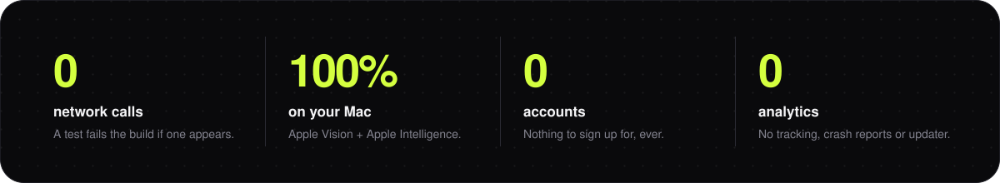

<div align="center">



<br><br>

<a href="https://github.com/AMAN123956/shotlight-releases/releases/latest/download/Shotlight.dmg"></a>

<br>

[](https://github.com/AMAN123956/shotlight-releases/releases/latest)
[](https://github.com/AMAN123956/shotlight-releases/releases)
[](#what-you-need)
[](#what-you-need)
[](#privacy)

**[Website](https://www.shotlight.lol)** · **[All versions and release notes](https://github.com/AMAN123956/shotlight-releases/releases)** · **[Report a bug](https://github.com/AMAN123956/shotlight-releases/issues/new/choose)**

</div>

---

Shotlight names every screenshot the moment you take it, and finds any of them by the words inside
(<kbd>⌥</kbd> <kbd>Space</kbd>). Everything runs on your Mac. No account, no analytics, and it never connects to the
internet.

> [!NOTE]
> This repository only holds the downloads and the bug tracker. There's no source code here.

## What it does



## Find anything with <kbd>⌥</kbd> <kbd>Space</kbd>



Remember one word and that's enough. Shotlight searches the text inside every screenshot, what was said in screen
recordings, the app each one came from and its name.

## What you need

| | |
|---|---|
| **Mac** | Apple silicon |
| **macOS** | 15 Sequoia or later |
| **Richer names** | macOS 26 with Apple Intelligence turned on. Otherwise Shotlight names each screenshot from the text it reads in it. |
| **Price** | Free. Every copy has every feature. |

## Opening it the first time



This early build isn't signed by Apple yet, so macOS asks you to confirm it once:

1. Open the `.dmg` and drag **Shotlight** to **Applications**.
2. Open Shotlight. macOS says it can't verify the app. Click **Done** (not Move to Trash).
3. Open **System Settings › Privacy & Security**, scroll down and click **Open Anyway** next to Shotlight. Confirm with
   your password.
4. Shotlight appears in the menu bar and walks you through setup.

<details>
<summary><b>Prefer Terminal?</b></summary>

<br>

```bash
xattr -dr com.apple.quarantine /Applications/Shotlight.app
```

</details>

> [!TIP]
> You do this once per version. After an update, macOS may also ask again for access to your Desktop. Both go away
> once Shotlight is signed by Apple.

## Updating

Shotlight never checks for updates by itself, because it never goes online. To update,
[download the latest version](https://github.com/AMAN123956/shotlight-releases/releases/latest/download/Shotlight.dmg)
and replace the app in Applications. Your names, search index and settings are kept.

Want to hear about new versions? Click **Watch › Custom › Releases** at the top of this page.

## Bugs and ideas

<div align="center">

[](https://github.com/AMAN123956/shotlight-releases/issues/new/choose)
&nbsp;
[](https://github.com/AMAN123956/shotlight-releases/issues/new/choose)

</div>

> [!WARNING]
> If you attach a screenshot to an issue, blur anything private first. Issues here are public.

## Privacy



Shotlight collects nothing. Your screenshots, the text read from them and the search index stay in
`~/Library/Application Support/Shotlight` on your Mac. Naming uses Apple Vision and, where available, Apple
Intelligence, both on-device. Speech in recordings is transcribed with a model macOS already has; Shotlight never
downloads one.

## Questions

<details>
<summary><b>Does it rename my old screenshots too?</b></summary>
<br>
Only if you ask. New screenshots are named as you take them. For the pile you already have, <b>Tidy Up</b> shows every
new name first, lets you uncheck any, and has one <b>Undo all</b> for 30 days. You can also make old screenshots
searchable without renaming them.
</details>

<details>
<summary><b>What happens to screenshots with passwords or API keys?</b></summary>
<br>
They're spotted on your Mac, blurred in previews, and kept out of search and Spotlight. Secrets never end up in a file
name. If you turn on <b>Guard › Expiring</b>, old one-time codes go to the Trash after a few days, with Restore.
</details>

<details>
<summary><b>Can I undo a rename?</b></summary>
<br>
Yes. Every rename has Undo, and Shotlight keeps the original name with the file, so you can restore it at any time.
Nothing is ever overwritten or permanently deleted.
</details>

<details>
<summary><b>Why isn't it on the Mac App Store?</b></summary>
<br>
Shotlight is distributed from its website and here, so it can stay free of accounts, purchases and update checks.
Homebrew is planned.
</details>

<div align="center">
<br>
<a href="https://www.shotlight.lol"><b>www.shotlight.lol</b></a>
<br>
<sub>Made for people with too many screenshots. Nothing ever leaves your Mac.</sub>
</div>
